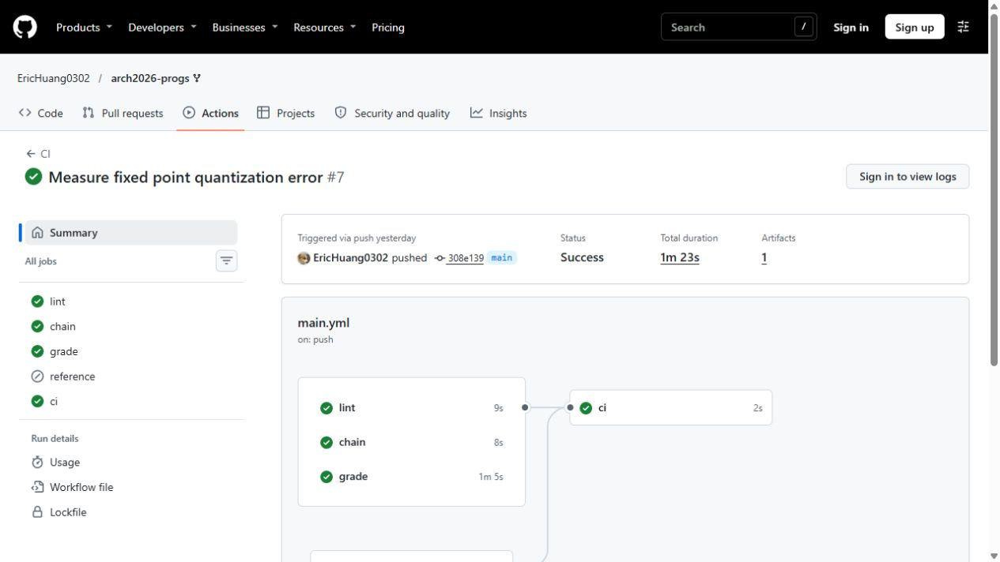
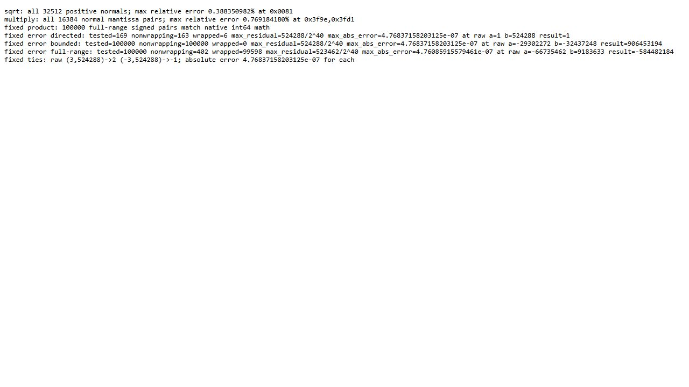
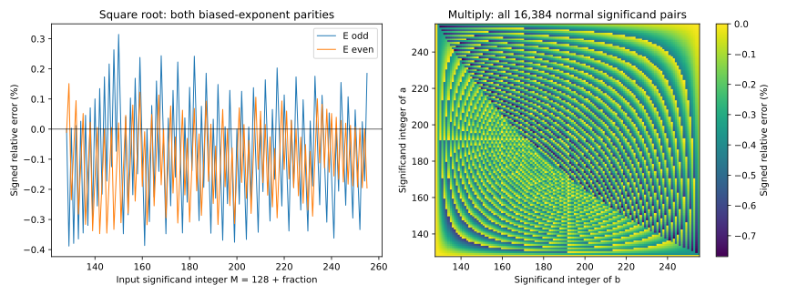
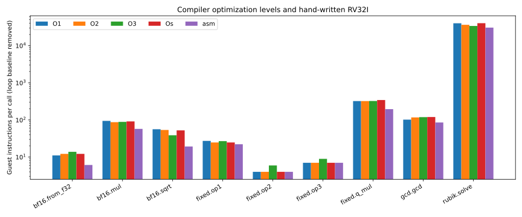
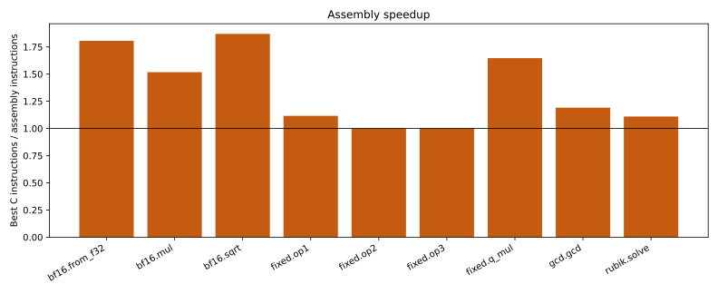
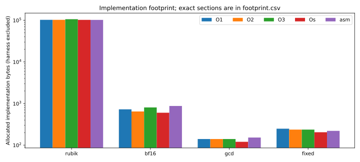

# Computer Architecture — Homework 2: Complete Applications on RV32I

## AI Tools Usage

OpenAI Codex was used for:

- C implementation and separately authored RV32I assembly, debugging, and code annotation.
- Test design, experiment scripts, numerical analysis, and interpretation of disassembly.
- Measurement collection, charts, and reproducibility checks.
- English technical writing and editing.

The maintained `.S` files are assembly source authored separately from GCC's output. Compiler disassembly is a comparison artifact. The measurements below come from the saved test runs. Longer derivations and complete tables are folded so that the main changes and results are easier to follow.

## Project Overview

This report documents four bare-metal programs for [Computer Architecture Homework 2][assignment], implemented in [my fork of arch2026-progs][fork]. Each required function has a portable C version and a hand-written RV32I version with an `_asm` suffix.

| Program | Required functions | Main question |
|---|---|---|
| Rubik | `rubik_solve` | How can a shortest-path solver fit both memory and instruction budgets? |
| BF16 | `bf16_from_f32`, `bf16_mul`, `bf16_sqrt` | How can integer instructions preserve the specified floating-point bit behavior? |
| GCD | `gcd_u32` | How can shifts and subtraction replace a divider? |
| Fixed | `op1`, `op2`, `op3`, `q_mul` | How do logical arithmetic and a signed fixed-point product behave at their boundaries? |

The starting point is the instructor's framework, with contracts in `src/<program>/<program>.h`. The contracts govern special values, rounding, wrapping, errors, and budgets. The runtime, tests, driver, build rules, and contract headers remain unchanged.

Stages 1–4 explain the algorithms, mathematics, assembly, verification, and measured changes. The later sections collect compiler comparisons, sizes, limitations, and reproduction commands. For the numerical analysis, I also use the instructor's [fixed-point line-drawing note][line-note] and [BF16 sine note][sine-note]. The measurements here are from this project.

## Summary

All four programs pass the instructor's tests at `-O1`, `-O2`, `-O3`, and `-Os`, and the C versions pass host AddressSanitizer and UndefinedBehaviorSanitizer checks. The [Linux CI run for the final implementation][source-ci] scores **100/100** using the instructor's harness and unmodified Linux emulator. Report quality is reviewed separately from that score.

Seven of the nine assembly functions beat the fastest measured compiler build. Subtraction and the overflow-safe unsigned average match its minimal sequences. The final revision improves the previous submitted assembly without changing the C implementations: narrowing drops from 11.25 to 6.125 measured instructions per call, the fixed-point product from 241 to 195.125, GCD from 85.75 to 85.3125, and Rubik from 30,926.5 to 30,573.1667 on the course's `-O2` benchmark workloads.

Rubik uses 102,290 allocated implementation bytes including code. Host verification checks shortest lengths and replays solutions over all 3,674,160 valid states; target verification separately sweeps all 2,644 distance-eleven states at every C optimization level. The largest assembly count in that sweep is 3,558,487, below the 7,500,000 limit. This does not claim that every assembly state was timed on target.

### Test results on GitHub

The screenshot below shows the successful CI run for `308e139`. The `lint`, `chain`, `grade`, and final `ci` checks all passed. The instructor-only `reference` job is skipped on forks. This screenshot records that run; it does not claim that later document edits were part of it.



The second screenshot shows the saved numerical-check output from the same source revision. It is a browser view of the archived log, rather than a new terminal run. BF16 errors and fixed-point sample counts can be checked against the [original log][numeric-review].

:::spoiler Host numerical-check output



:::

## Environment and measurement method

### Bare metal and the instruction-set boundary

:::spoiler Environment details and recorded versions

The guest is a freestanding ELF loaded at `0x10000`. [`_start`][startup] sets the stack pointer, clears `.bss`, and calls `main`; the linker reserves a 4 KiB stack. The guest does not boot Linux. The fixed harness prints through emulator-supported environment calls and reads counters. None of the implementation objects issues an environment call or accesses a CSR.

| Component | Recorded configuration |
|---|---|
| Instructor framework | `fd2d7c17db223807c342e3f210c769d23d1865b1` |
| Final implementation | `dfd1e8504a0e7f16d6fc15a02acdd7bd7ba09bae` |
| Comparison baseline | `382db5609e3d66a1b7d15f23396b77eae024c7d8` |
| Cross compiler | xPack RISC-V GCC 15.2.0-1; GCC 15.2.0; binutils 2.45 |
| Target flags | `-march=rv32i_zicsr -mabi=ilp32 -ffreestanding -fno-pic -fno-stack-protector` |
| C optimization levels | `-O1`, `-O2`, `-O3`, `-Os`; no `-Ofast` |
| rv32emu | `158b57e9eab99d59e01141cd0e477b06b44b8fe3` |
| Emulator mode | System interpreter, `ELF_LOADER`, M/A/F/C disabled |
| Host checks | MSYS2 clang64 Clang 21.1.1, ASan and UBSan, recovery disabled |
| Formatting | clang-format 20.1.8 |
| Charts | Python 3.13.11 and matplotlib |

RV32I supplies integer shifts, logic, comparisons, addition, and subtraction. There is no hardware multiply, divider, floating-point unit, or count-trailing-zeros instruction in this configuration. The C runtime may supply `__mulsi3` and the listed memory/string helpers; it supplies no `__muldi3`. In particular, writing a 64-bit multiplication expression in C is not sufficient if GCC lowers it to that missing helper.

The native Windows emulator uses a disclosed host compatibility patch selecting its existing malloc memory backend, plus build settings excluding unused Linux device objects. The guest implementation and instruction accounting are unchanged. The independent Linux CI builds the instructor's emulator without that patch. [HANDOFF.md][handoff] records both setups. These results are simulator results; no physical RISC-V board was used.

The Lab 2 playground was also run in system emulation at `-O0` and `-O2`, with `make clean` between levels. Its eight checks pass and the six measured totals match the handout. Those [local exercise logs][lab-logs] are supporting setup evidence.

:::

### What a measured cycle means here

rv32emu advances one guest-instruction counter and exposes it through both `cycle` and `instret`. It has no timing model. These counts do not describe pipeline stalls, branch misprediction, caches, or physical clock frequency.

The harness uses [`get_cycles()` and `get_instret()`][perf] to read a 64-bit counter on RV32:

```asm
csrr a1, cycleh
csrr a0, cycle
csrr a2, cycleh
bne  a1, a2, get_cycles
```

The second high-word read detects a low-word rollover; the function retries instead of combining incompatible halves. The analogous function reads `instreth/instret`. Their return pair is `a1:a0` under ILP32.

For each function, the [benchmark macro][bench] executes the same input array once for C and once for assembly. It folds results into an observable checksum. Initialization and printing are outside the timed region. It also times a baseline loop with the call replaced by its input:

$$
C_{\text{call}}=\frac{C_{\text{timed loop}}-C_{\text{baseline loop}}}{N}.
$$

All differences are 64-bit. The baseline removes loop control, input handling common to that loop, checksum work, and counter-read overhead according to the harness's model. Additional argument expressions and call-site details can remain. The numbers are therefore corrected benchmark costs, not an instruction-by-instruction census of a callee body. Raw `cycle` and `instret` intervals can differ slightly because they are read at different instruction boundaries, despite referring to the same underlying counter.

The assembly object is identical across the four ELFs, but its caller is compiled at each level. The main table displays assembly from the `-O2` ELF. Speedup instead compares C and assembly in the **same ELF as the fastest C version**. This distinction matters for small routines. One run suffices for deterministic counts; no wall-clock speedup is inferred.

### Inputs and controlled alternatives

The course benchmark uses six cubes at distances 0, 2, 4, 6, 8, and 9. BF16 uses sixteen characteristic words; GCD derives its second operand as `(in >> 7) | 1`; the fixed-point product uses `(int32_t) in` and `(int32_t) (in >> 5)`. These are the unchanged published workloads, not all-input averages. Their exact arrays are in the [benchmark sources][benchmark-sources].

The new [experiment runner][experiments] reconstructs assembly alternatives from the fixed baseline, links the same C/main/test/runtime objects, and executes the full suite at all four levels. The source snapshots, logs, cycle differences, and sizes are retained. Alternatives such as removing byte skipping are **controlled ablations made for this report**, not claims about historical development order.

A second workload uses 256 full-range pseudorandom operand pairs. Its generator and the preceding correctness stream are fixed in [target_stress.c][stress-source]. It keeps array indexing in both timed call expressions, so absolute costs from that workload are compared only within it.

## Stage 1: Porting Mini-Rubik to bare metal

The main change from HW1 is the search. Instead of carrying the old IDA* design into the new framework, I use a small exact perimeter and search the remaining prefix on target. The difficult part is meeting the tighter assembly budget while still returning a shortest solution.

### The state and the contract

[`rubik_solve`][rubik-c] accepts seven cubie digits followed by seven orientation digits. The solved string is `12345671111111`. Cubies must form a permutation of `1` through `7`; orientation digits minus one must sum to zero modulo 3. One reference corner is fixed, leaving

$$
7!\times3^6=5,040\times729=3,674,160
$$

valid states. The allowed unit-cost moves are `R R2 R' B B2 B' D D2 D'`. A half turn counts as one move in this half-turn metric.

The [contract][rubik-h] requires a shortest move sequence, separated by single spaces and NUL-terminated. Invalid input returns `-1` without changing the output. Insufficient capacity returns `-2` and clears `out[0]` when capacity is nonzero. A solved cube writes the empty string and returns zero.

My Homework 1 solver used projected permutation/orientation distances with IDA*. This port replaces that search engine with an exact radius-five perimeter and a short prefix search. The previous Ripes measurements concern a different algorithm and execution environment and are not used as this port's baseline.

### Packing a valid state

The target holds the permutation `p` in seven three-bit lanes and six independent twists `o` in two-bit lanes. The remaining twist follows from the modulo-three invariant. A move changes these components separately: bit operations permute cubie lanes, while a small orientation transition table updates twists.

The membership key needs fewer bits than the complete lane representation:

```c
return (p & 32767u)
     | (((p >> 15 & 7u) > (p >> 18)) << 15)
     | (o << 16);
```

The first fifteen bits identify five distinct cubies. The two missing identities are determined by that set; one ordering bit identifies their placement. The twelve orientation bits begin at bit 16. Thus the 28-bit key is injective over valid states. It is not a dense rank and does not require division or multiplication on target.

Four high bits of a table word store the exact distance. The solved key is nonzero, and valid permutations cannot have all five retained cubie identities equal to zero, so the zero word is an unambiguous empty slot.

### What is precomputed, and what still runs on target

The [host generator][rubik-generator] temporarily performs full BFS. Only the following data is retained in each target implementation:

| Data | Entries | Bytes |
|---|---:|---:|
| Radius-five membership table, including unused hash slots | 16,384 words for 12,224 states | 65,536 |
| Sorted distance-eleven keys | 2,644 words | 10,576 |
| Three orientation transition rows | `3 × 4,096` halfwords | 24,576 |
| Assembly move-name bytes | 18 | 18 |
| Total assembly `.rodata` | | 100,706 |

The orientation rows include unused packed indices to make a row stride a power of two. Only valid indices are reached. The C object has a few additional string/alignment bytes and contains 100,712 bytes of `.rodata`. Each object defines its own tables; neither relies on the other implementation's data.

The full 3,674,160-state distance array and BFS queue are host verification/generation storage and are not linked into the target. The target searches the input's prefix and reconstructs its suffix; it has no complete answer table.

### Exact membership in at most three probes

The lookup checks at most three slots. It compares the complete key each time, so a collision cannot return another cube’s distance.

:::spoiler Hash formulas and a worked lookup

Let `k` be the state key. The candidate indices are

$$
\begin{aligned}
h_1(k)&=(k\oplus(k\gg7)\oplus(k\gg14))\mathbin{\&}(2^{14}-1),\\
h_2(k)&=(k\oplus(k\gg5)\oplus(k\gg17))\mathbin{\&}(2^{14}-1),\\
h_3(k)&=h_1(k)\oplus h_2(k).
\end{aligned}
$$

The offline three-choice cuckoo construction places every retained key in one candidate slot. A probe compares all 28 key bits, so a hash collision cannot become a false match. Construction retries/relocations belong to the host; the target performs at most three reads and never searches a collision chain.

For the one-turn input `25314672313211`, packing gives `p=0x1ab0a1`, `o=0x189`, and `k=0x018930a1`. Its candidate slots are 9,444, 14,816, and 7,428. The first contains `0x118930a1`: the low bits match and its high nibble says distance 1. The suffix search finds `R'`, whose replay reaches the solved state. This is a lookup of an exact distance followed by a move search, not a stored text answer.

:::

### Why the returned path is shortest

The prefix search stops at the radius-five table. Trying prefix lengths in increasing order keeps the final solution shortest; skipping consecutive turns of one face does not remove an optimal path.

:::spoiler Shortest-path argument

Inside the perimeter, a state at distance `d>0` has a neighbor at distance `d-1`. Repeatedly taking such a neighbor reaches solved in exactly `d` moves.

For an outside state of true distance `D`, the target tries prefix lengths 1 through 6. Along an optimal path, the first `D-5` moves reach the radius-five perimeter. No prefix of length `k<D-5` can reach it: such a hit would produce a complete path of length at most `k+5<D`, contradicting the definition of `D`. The first successful prefix therefore has length `D-5`, and its exact suffix completes an optimal path.

The host BFS establishes diameter 11. Membership in the complete distance-eleven list therefore permits starting directly at prefix length 6. Other outside states need at most five prefix moves. Consecutive moves of the same face are skipped because they combine into one allowed turn or cancel, so no shortest path is lost.

This is depth-first iterative deepening ending in a perimeter. It does not evaluate the projected-distance `h` from my Homework 1 IDA* loop.

:::

### Assembly layout and the measured refinement

In [`rubik.S`][rubik-asm], the entry frame keeps output arguments and a local eleven-byte path. Recursive prefix frames preserve the packed state, depth, previous face, path pointer, and loop position. Quarter turns and membership queries use caller-saved registers. The maximum implementation stack use is

$$
64+6\times48+16+48=416\text{ bytes},
$$

including the deepest search chain, leaf frame, and suffix frame. The harness/caller also uses stack space; 416 is the solver's own bound, not total program stack use.

The first refinement replaces a constant mask with shifts:

```asm
# Low fifteen permutation bits; t0 starts the state key.
slli t0, a0, 17
srli t0, t0, 17
```

RV32I cannot encode `32767` in one signed twelve-bit `andi` immediate. The old `li 32767` expands to two instructions, followed by `and`; the two shifts remove one instruction from every membership query.

The second refinement delays the second hash until the first probe misses. It saves six instructions on a first-slot hit and leaves the miss path's arithmetic count unchanged. An initial near-state query and the suffix frequently hit; deep prefix leaves frequently miss. Both paths retain the same maximum of three probes.

| Controlled variant | Corrected instructions/call, `-O2` ELF | Assembly `.text` |
|---|---:|---:|
| Previous submission | 30,926.5000 | 1,588 B |
| Compact key extraction only | 30,634.1667 | 1,584 B |
| Lazy second hash only | 30,865.5000 | 1,588 B |
| Both, accepted | 30,573.1667 | 1,584 B |

GCC `-O3` aggressively expands/inlines parts of the C suffix and lookup work. The C code reaches 5,568 text bytes there, versus 1,740 at `-Os`, and its benchmark is faster. The hand-written version keeps small subroutines with explicit register preservation. Its best-C comparison is 33,934.1667 versus 30,575.6667 in the same `-O3` ELF, a 1.11× improvement. The [complete listing directory][all-disassembly] retains all four compiler builds and the assembly object.

### Why a small benchmark cannot select every optimization

Removing diameter-list selection saves a lookup on the course benchmark, which has no distance-eleven cube: its old-lookup cost falls slightly to 30,867 instructions per call. The controlled worst-state experiment tells a different story:

| Implementation at `54721631111111` | Raw instructions |
|---|---:|
| Old lookup, diameter selection retained | 3,592,364 |
| Old lookup, try every prefix length | 5,078,021 |
| Accepted lookup, diameter selection retained | 3,558,487 |

All return the same eleven-move solution. These counts include counter-read overhead. The ablation isolates why skipping impossible depths is valuable even though its selection overhead can lose on shorter cubes. I retain the diameter list. [Sources and raw logs][optimization-data] preserve the experiment.

### Verification and the budget boundary

The course suite covers every distance from zero to eleven, all nine single moves, an eleven-move chain, malformed inputs, repeated cubies, invalid twists, and output capacities around an exact fit. For `L>0`, required capacity is `2L+t`, where `t` counts two-character move tokens; this includes separators and the NUL. The solved state needs one byte. The implementation measures before writing.

:::spoiler Full-state checks and the instruction-budget argument

The [full-domain host checker][full-cube-source] independently builds BFS distances using the offline face model, calls the C solver on every valid state, checks its length against BFS, and replays the returned tokens using the reference moves. All 3,674,160 states pass. The same complete run passes ASan/UBSan. The checker shares the published move model with generation; the course vectors provide a separate external check of that model. It does not validate assembly by executing it on the host.

The [target diameter sweep][diameter-source] executes both C and assembly on all 2,644 distance-eleven states, independently replays both outputs, and checks each call's budget:

| Build | Largest C count | Largest assembly count |
|---|---:|---:|
| `-O1` | 4,748,454 | 3,558,487 |
| `-O2` | 4,295,305 | 3,558,487 |
| `-O3` | 4,038,954 | 3,558,487 |
| `-Os` | 4,748,384 | 3,558,487 |

Every maximum occurs at `54721631111111`. The C limit is 50,000,000, and the assembly limit is 7,500,000. These are raw per-call measurements with overhead, distinct from the corrected six-state benchmark average.

For a non-diameter state, prefix limits one through five visit at most

$$
\sum_{k=1}^{5}\left(1+9\sum_{j=0}^{k-1}6^j\right)=16,790
$$

nodes including roots. A conservative source/disassembly inspection allows 400 exclusive instructions per visit, charging a quarter-turn to its child, plus 20,000 for parsing, suffix recovery, and output. This gives 6,736,000, below the assembly budget. This is a conservative analytical argument, not a mechanically certified bound or an exhaustive target timing of the other states. The complete deeper class is the measured diameter sweep.

:::

### Applications and limits

The implementation illustrates how exact end-region distances can replace a complete answer table when a target must compute a short path. Related memory/search tradeoffs appear in optimal planning; [Korf's pattern-database work][korf] uses exact subproblem distances as admissible heuristics. This solver's table instead stores a full-state perimeter, so the algorithms and table meanings differ.

A similar design could support a small robot's reversible configuration graph when moves have equal cost and a bounded terminal region fits in memory. That is an application of the graph argument, not a deployment tested here. Different move costs, irreversible transitions, or a larger state space require new distance data, bounds, and validation. The constants 5 and 11 belong to this cube model.

## Stage 2: BFloat16 without floating-point instructions

Here the bit pattern is the interface. I first keep the quiz’s special cases and rounding rules unchanged, then work on the integer operations that cost the most. The final assembly uses a short mantissa product and a 256-byte square-root table.

### Fields, range, and precision

The [BF16 contract][bf16-h] uses one sign bit, an eight-bit exponent with bias 127, and a seven-bit stored fraction. Let the fields be `s`, `E`, and `f`. A normal value has an implicit leading one:

$$
x=(-1)^s(128+f)\,2^{E-134},\qquad 1\le E\le254.
$$

| Encoding class | Value or interpretation |
|---|---|
| `E=0, f=0` | Signed zero |
| `E=0, f>0` | Subnormal: `(-1)^s f 2^-133` |
| `1 ≤ E ≤ 254` | Normal, with eight significant bits |
| `E=255, f=0` | Signed infinity |
| `E=255, f>0` | NaN |

The smallest positive subnormal is `2^-133`; the smallest positive normal is `2^-126`. The largest finite magnitude is `(2-2^-7)2^127`, about `3.3895 × 10^38`. Within `[2^e,2^(e+1))`, adjacent normal values differ by `2^(e-7)`. This relative spacing lets BF16 retain binary32's exponent range while spending fewer bits on precision.

For a normal result rounded to nearest, the absolute error is at most half a spacing, and the relative error is at most `2^-8`. That statement does not cover overflow to infinity, and subnormals need an absolute-error bound. It also does not make this assignment's truncating multiply or approximate square root correctly rounded.

### Narrowing binary32 and the tie-to-even term

[`bf16_from_f32`][bf16-c] receives the binary32 **bit pattern**, not a `float` argument. Write it as `u = H·2^16 + L`, with high half `H` and discarded low half `L`. For a finite input, the C expression is

```c
return (uint16_t) ((f32bits + 0x7fffu
                   + ((f32bits >> 16) & 1u)) >> 16);
```

The low-half addition carries exactly when `L>0x8000`, or when `L==0x8000` and the low bit of `H` is one. Thus a tie increments an odd retained significand to an even one; an even one stays unchanged.

| Input bits | Retained half before rounding | Result | Reason |
|---|---|---|---|
| `0x3f807fff` | `0x3f80` | `0x3f80` | Below halfway |
| `0x3f808000` | `0x3f80` | `0x3f80` | Tie, retained bit even |
| `0x3f818000` | `0x3f81` | `0x3f82` | Tie, retained bit odd |
| `0x7f7fffff` | `0x7f7f` | `0x7f80` | Rounding carries into infinity |

An input exponent of 255 returns its high half unchanged. That is a bit rule, not a promise to retain a NaN's classification: `0x7f800001` loses its low payload and becomes `0x7f80`, as the contract requires.

### A general early-return condition

The new [`bf16_from_f32_asm`][bf16-asm] first executes:

```asm
slli t0, a0, 16
bgez t0, .Lf32_top
```

After the shift, the sign bit of `t0` is bit 15 of the discarded half. When it is zero, `L<0x8000`. Even the largest bias cannot generate a carry: `32767+32767+1=65535`. Returning the high half is therefore correct for every finite input in that half-range. For infinities and NaNs, returning the high half already is the required behavior, so the exponent check can be skipped too.

The other branch retains the original special-value and tie-to-even handling. The optimization tests a property of all inputs; it contains no benchmark constants. It adds eight code bytes and makes the upper-half rounding path two instructions longer, while shortening the no-round path.

| Narrowing experiment | Corrected instructions/call, `-O2` ELF | Complete BF16 `.text` |
|---|---:|---:|
| Previous submission | 11.2500 | 608 B |
| Low-half guard, accepted | 6.1250 | 616 B |

The course workload has many small discarded halves. On the separate full-range random workload, the corresponding cost falls from 15.0000 to 12.7461, a smaller gain. Those figures retain extra input-array addressing, so they are not substituted into the course table.

The compiler's `-O1` narrowing is essentially the original mask, classification branch, bias construction, two additions, and right shift. At `-O2` and other levels, scheduling and the caller change the measured cost. The retained [listings][bf16-dis] show the two-instruction expansion of `li 0x7fff`; the early-return path avoids those instructions altogether. The final same-ELF comparison is 11.0625 for the best C build and 6.125 for assembly, or 1.81×.

### Multiplication without a multiplier

For normal inputs, let `Ma=128+fa` and `Mb=128+fb`. The exact integer significand product is `P=Ma·Mb`, in `[16384,65025]`. If bit 15 is set, normalization shifts by eight; otherwise it shifts by seven:

$$
t=[P\ge2^{15}],\qquad S=P\gg(7+t),\qquad E_r=E_a+E_b-127+t.
$$

Packing `S & 127` removes the implicit one. As an example, `1.5 × 2.0` uses `192 × 128 = 24576`, gives `S=192`, `E_r=128`, and result `0x4040`, or 3.0.

Subnormal operands are normalized first by shifting their fraction until bit 7 becomes one and reducing the effective exponent. Both normalized significands then have eight bits with a known leading one. The C version uses a bounded 32-bit product, lowered through the supplied `__mulsi3` when needed. The assembly specializes that product:

```asm
slli a5, t1, 7
.rept 7
andi t2, t0, 1
beqz t2, 1f
add  a5, a5, t1
1:
srli t0, t0, 1
slli t1, t1, 1
.endr
```

Here `t0=Ma`, `t1=Mb`, and `a5` is the product. The first shift includes the known `2^7·Mb` term. The seven unrolled steps add the remaining terms `bit_i(Ma)·Mb·2^i`. There is no general 32-bit multiplier loop or call frame. This spends instruction storage to specialize a bounded operand width; it does not introduce an M-extension instruction.

The measured multiply cost is 57.3125 versus 87.0 for the fastest C build. The multiply sequence itself is unchanged in the latest refinement. The experiment's unchanged multiply measurements help show that the narrowing gain did not come from relaxing another function.

### Special values and the underflow quirk

Operand order matters. A NaN first operand is returned unchanged. An infinite first operand multiplied by a nonzero NaN second operand returns signed infinity. Only after processing the first operand's special case is the second examined. Consequently, commutativity is not asserted for NaNs. Infinity times signed zero produces the designated quiet NaN; finite zero products keep the XOR sign.

Normal products truncate the significand. For a finite non-underflowing result, less than one output significand unit is discarded, so

$$
\frac{|\widehat{x y}-xy|}{|xy|}<\frac1{128}=0.78125\%.
$$

The quiz's underflow rule is different: it removes the hidden one **before** shifting the stored fraction. For example, `0x0080 × 0x3f00` returns zero here, although the real product is `2^-127`, a representable BF16 subnormal. Its relative error against real arithmetic is 100%. This is preserved contract behavior, not evidence for a universal sub-one-percent multiplication bound. Overflow, zeros, infinities, and NaNs are checked by their specified bits rather than a finite relative-error formula.

### Deriving the exact square-root search target

The important detail is the quiz’s truncating comparison. Replacing it with an ordinary integer square root changes some answers: at `m=130`, the required result is 129, not 128.

:::spoiler Deriving the square-root formula and C implementation

For a positive normal input, write the significand integer as `M=128+f`. If the actual exponent is odd, double `M` to make that exponent even. Since the bias is odd, this happens when the stored exponent `E` is even. Let the adjusted integer be `m`.

The quiz seeks the largest integer `r` such that `floor(r²/128) ≤ m`. Because both sides are integers,

$$
\left\lfloor\frac{r^2}{128}\right\rfloor\le m
\iff r^2<128(m+1)
\iff r^2\le128(m+1)-1.
$$

Therefore

$$
r=\left\lfloor\sqrt{128(m+1)-1}\right\rfloor,
\qquad E_{\text{out}}=\left\lfloor\frac{E+127}{2}\right\rfloor.
$$

The `+1` and `-1` are essential. At `m=130`, this gives 129; using `floor(sqrt(128m))` gives 128 and changes the required result.

The C implementation uses a restoring integer square root with additions, comparisons, and two-bit steps. It maintains a remainder and partial root rather than multiplying a trial midpoint. The core is:

```c
unsigned trial = root + bit;
if (remainder >= trial) {
    remainder -= trial;
    root = (root >> 1) + bit;
} else
    root >>= 1;
```

Here `remainder` starts at `128(m+1)-1`, and `bit` starts at `1<<14` and moves down by two positions. The algorithm tests successive binary root bits; subtracting a successful trial accounts for the incremental square term. This avoids the missing multiplier while computing the same integer `r`.

:::

### Replacing bounded arithmetic with 256 exact bytes

There are only two possible domains: `m=M` for `M=128..255`, and `m=2M` over the same 128 significands. The assembly indexes two 128-byte blocks. Each byte stores the exact integer root, which lies in `[128,255]`; the output discards its hidden bit when packing.

```asm
andi t1, a0, 127
andi t2, t0, 1
bnez t2, .Lsqrt_lookup
addi t1, t1, 128
```

At this point `t0=E`. The exponent parity chooses a block and the fraction chooses an entry. The [table generator][bf16-generator] uses the derived integer target. This is an exhaustive table for a small internal argument, not a collection of benchmark answers.

The earlier table represented all adjusted `m` values from 128 through 511, including odd doubled values that never occur. Compression retains only the two real domains:

| Square-root table revision | Corrected square-root cost | Complete BF16 `.text` | `.rodata` |
|---|---:|---:|---:|
| Before compression | 19.4375 | 612 B | 384 B |
| Compressed table | 19.1875 | 608 B | 256 B |
| Current, including narrowing guard | 19.1875 | 616 B | 256 B |

The first comparison is a genuine retained before/after measurement; the last row's eight extra code bytes belong to narrowing. Table compression also removes one index shift. The raw records are in [the earlier measurement set][earlier-measurements] and [the current set][current-data].

For `sqrt(2)`, `E=128` and `M=128`, so `m=256`, `r=181`, and the returned encoding is `0x3fb5`, or 1.4140625. Special cases run before the lookup: NaNs preserve their bits, positive infinity is unchanged, negative nonzero values produce quiet NaN, either signed zero produces positive zero, and positive subnormals produce positive zero.

### Error measurements and what they establish

For `q=sqrt(128m)`, the root rule gives `r>q-1` and `r≤sqrt(q²+127)`. Since `q≥128`, a conservative relative bound is below `1/128`. The actual maximum is much smaller and is measured over the complete positive-normal input set:

| Host comparison | Inputs | Largest relative error magnitude |
|---|---:|---:|
| BF16 square root versus double-precision `sqrt` | 32,512 positive normal encodings | 0.388350982% |
| BF16 multiply versus exact normal significand product | 16,384 pairs at unit exponents | 0.769184180% |

The square-root maximum first occurs at `0x0081`; powers-of-two scaling repeats the same significand/parity errors. Multiplication reaches its maximum at `0x3f9e` and `0x3fd1`. For results that remain normal, scaling by an exact power of two preserves that relative truncation error. The [host reference program][numeric-reference] runs under sanitizers and retains the precise results.



**Reading the figure:** the left panel evaluates the two 128-entry root cases; the right evaluates every pair of normalized significands. Multiplication errors are nonpositive for positive operands because the product truncates. The plotted integer formulas agree with the executed host-reference maxima. The [plot script][error-data] and `bf16-error.csv` in the [recorded measurements][current-data] preserve the calculation. The figure excludes underflow and special values, whose behavior was described separately.

The course tests cover all 65,536 square-root encodings, including exceptional classes. Narrowing tests exercise every discarded half under sixteen characteristic retained halves, and every retained half under five boundary low halves. Multiplication uses golden cases, a characteristic 256×256 grid, all 65,536 patterns against eight constants, and applicable algebraic laws. The [additional target stream][stress-source] also checks 100,000 full-range narrowing inputs against a comparison-based reference.

The square root is exact relative to the quiz's integer rule and still approximates the real square root. These are separate correctness claims. The host numerical maximum is a floating-point measurement, not a certified real-arithmetic interval proof.

### Applications and limits

[Google's Cloud TPU documentation][tpu-bf16] describes BF16 multiplication with FP32 accumulation and the storage/bandwidth advantage of a 16-bit representation. That motivates reduced-precision formats, but TPU behavior is not the specification here: its conversion flushes subnormals, while this assignment defines its own conversion and underflow rules. This integer implementation is an exercise for a processor without F or M extensions, not a replacement TPU arithmetic library.

The broader technique is to derive a bounded internal domain before choosing arithmetic or a lookup table. A small exact table can remove repeated products from a critical path, but its memory cost and the application's numerical rules must be checked explicitly.

## Stage 3: Binary GCD without a divider

This program needs no multiplication or division. Most of the work is removing powers of two and subtracting the smaller odd operand. The useful assembly change turned out to be a small branch-layout adjustment, rather than a more complicated algorithm.

### Binary identities and termination

The [contract][gcd-h] defines unsigned 32-bit `gcd_u32`, including `gcd(a,0)=a` and `gcd(0,0)=0`. The implementation follows the binary identities documented by [NIST][binary-gcd]:

$$
\begin{aligned}
\gcd(2a,2b)&=2\gcd(a,b),\\
\gcd(2a,b)&=\gcd(a,b) &&\text{when }b\text{ is odd},\\
\gcd(a,b)&=\gcd(a,b-a) &&\text{when }0<a\le b.
\end{aligned}
$$

The first identity factors out a common two; the second removes a factor that cannot divide the odd operand; the third preserves common divisors under subtraction. After both operands are odd, a nonzero difference is even and can be shifted before the next comparison.

The algorithm keeps a count `k` of removed common factors. The invariant is `gcd(original_a,original_b)=2^k gcd(current_a,current_b)`. The positive sum decreases after a subtraction, and shifts reduce a nonzero even operand. Therefore the process terminates. Zero checks precede the shift loops, so zero cannot become an endless sequence of right shifts.

For `gcd(48,18)`, one common shift gives `(24,9)` and `k=1`. Removing factors from 24 gives `(3,9)`. Subtracting gives `(3,6)`, then shifting gives `(3,3)`. Equality produces the odd core 3; restoring `2^1` gives 6.

This is exact integer arithmetic. There is no quantization error. The implementation subtracts the smaller unsigned operand from the larger, and the restored mathematical GCD cannot exceed the original operands, so the final shift does not lose result bits.

### How the assembly differs from the C loop

The [C version][gcd-c] swaps operands when necessary, then subtracts from one designated operand. The [assembly][gcd-asm] uses two subtraction directions and strips the even difference in place:

```asm
bltu a0, a1, .Lgcd_sub_b
sub  a0, a0, a1
beqz a0, .Lgcd_equal
```

Unsigned `bltu` is required: values such as `0xffffffff` are valid positive inputs, not negative integers. Avoiding a general swap removes repeated moves from the hot path. The [compiler listings][gcd-dis] show that `-O2` uses extra register moves when selecting its subtraction operands.

For the initial even first operand, a byte test skips eight zero low bits at once. No multiply-based de Bruijn index, division helper, or unavailable `ctz` is needed. After a subtraction, the smaller bit-strip loop remains useful because most differences have only a few trailing zeros.

### A small branch change and a rejected larger one

The latest refinement makes the even path fall through:

```asm
.Lgcd_a:
andi t1, a0, 1
bnez t1, .Lgcd_b
.Lgcd_a_shift:
```

The old layout branched to the even block and jumped unconditionally to the odd continuation. The inverted branch eliminates that jump and four code bytes without changing state transitions.

| Controlled variant | Corrected instructions/call, `-O2` ELF | `.text` |
|---|---:|---:|
| Previous submission | 85.7500 | 156 B |
| Remove initial byte skip | 91.5000 | 144 B |
| Fallthrough change, accepted | 85.3125 | 152 B |
| Also check for eight common zero bits | 88.1250 | 180 B |

The common-byte check has a plausible advantage for inputs sharing large powers of two, but it adds work on the published workload, whose derived second operand is odd. It is rejected here rather than described as a universal speedup. The separate random workload also favors the accepted branch layout, 225.0313 versus 225.6758 for the old assembly.

The fastest C build is `-O1` at 101.625. The same-ELF assembly cost is 85.3125, or 1.19× faster. The smallest C object is 120 bytes at `-Os`, smaller than the 152-byte assembly. The initial byte shortcut spends code size to save shifts; the assembly is faster on these workloads, not smaller in every comparison.

### Verification and applications

The course tests combine directed vectors, zero behavior, symmetry, scaling identities, divisibility, and reference comparisons. Budget checks include expensive large operands; the accepted `-O2` assembly's largest sampled call is 322 instructions including measurement overhead, well below 1,500. The bound is for every input under the contract; a sampled maximum alone is not an exhaustive proof over `2^64` operand pairs.

The additional target test checks 10,000 full-range random pairs and 256 directed pairs against Euclid's algorithm. Its reference computes remainders by binary long division rather than reusing this binary-GCD loop. C and assembly both match. The same reference and C implementation run under host sanitizers.

One concrete use is reducing an exact rational number: divide numerator and denominator by their positive GCD, with denominator zero rejected by the application. For example, `48/18` becomes `8/3`. GCD also determines whether a modular inverse can exist: the operands must be coprime. This implementation supplies that integer primitive only; it is not an extended-GCD inverse routine. Its data-dependent branches and iteration count do not provide constant-time behavior for secret operands.

## Stage 4: Bitwise arithmetic and Q11.20 multiplication

The first three functions show why the mathematical result is not always the whole contract: `op1` must also return its loop count. For `q_mul`, the main issue is forming a signed 64-bit product on RV32I and keeping the specified rounding and wraparound behavior.

### An adder whose pass count is observable

The [fixed contract][fixed-h] makes `op1` return both the sum modulo `2^32` and its number of carry-propagation passes. At each bit position, XOR gives the sum without an incoming carry, while AND identifies a carry to the next bit:

$$
a+b=(a\oplus b)+2(a\mathbin{\&}b).
$$

The [C loop][fixed-c] applies that identity repeatedly:

```c
uint32_t carry = (a & b) << 1;
a ^= b;
b = carry;
++*n;
```

At each pass, `a+b` remains the original sum modulo `2^32`. A nonzero carry's least significant set bit moves upward, so no more than 32 passes are needed. Unsigned operations define the intended wrapping and avoid undefined signed overflow.

For `op1(0xffff,1)`, sixteen low one-bits propagate a carry into bit 16; one final pass incorporates it. The result is `0x10000` with 17 passes. For a zero second operand, the loop executes zero times. Replacing the whole function by `add` would lose the required pass count even if the sum were correct.

The [assembly][fixed-asm] uses `a0/a1` for the evolving sum and carry, `a2` for the output pointer, `t0` for the pass count, and `t1` for carry scratch. Its loop has one counter increment. GCC `-O2` keeps an additional register move in the corresponding count update; these two consecutive instructions come from the [listing][fixed-dis]:

```asm
addi a4, a5, 0
addi a5, a5, 1
```

The compiler keeps the current count in `a4` while advancing `a5`. The maintained assembly increments its count directly. The benchmark wrapper folds the count into its checksum, so the improvement is measured with the count observable: 22.125 instructions per call versus 24.6875 for the fastest C build.

### Subtraction and an average that cannot overflow

`op2(a,b)` is subtraction modulo `2^32`. Although its logical derivation is `a+(~b+1)`, the contract permits the direct operation, and RV32I supplies `sub`. Both GCC and the maintained assembly reduce it to subtraction and return. There is no useful loop to preserve here.

For `op3`, computing `(a+b)>>1` in 32 bits would first wrap the sum. Instead, use the exact integer identity above and divide it by two:

$$
\left\lfloor\frac{a+b}{2}\right\rfloor
=(a\mathbin{\&}b)+\left((a\oplus b)\gg1\right).
$$

The result lies between the operands and never exceeds `UINT32_MAX`, so the addition on the right also fits. At `a=b=0xffffffff`, the formula returns `0xffffffff`; an overflowing sum followed by a shift would return `0x7fffffff`.

```asm
and  t0, a0, a1
xor  a0, a0, a1
srli a0, a0, 1
add  a0, a0, t0
ret
```

The compiler emits the same four arithmetic operations with different register choices. The measured costs match: 4.0 for subtraction and 7.0 for the average in the best comparison ELFs. Those corrected benchmark figures include the remaining call-site effects; they are not claims that the bodies contain four and seven instructions respectively.

### Deriving the Q11.20 operation

A signed stored integer `A` represents `a=A·2^-20`. In this convention the sign bit is separate from the eleven integer bits:

| Field | Bits |
|---|---:|
| Sign | 1 |
| Integer field, excluding sign | 11 |
| Fraction | 20 |

The range is `[-2048, 2048-2^-20]` and the resolution is `2^-20`, about `9.536743 × 10^-7`. The represented operands' exact product is

$$
ab=AB\,2^{-40}.
$$

To return to the same scale, the unrounded stored result would be `AB/2^20`. The contract rounds by adding half a stored unit before taking the floor:

$$
R=\left\lfloor\frac{AB+2^{19}}{2^{20}}\right\rfloor,
\qquad \text{return the low 32 bits of }R.
$$

This rounds a halfway result toward positive infinity, including a negative halfway result. The examples below use **stored integers**, not real operands of magnitude three:

| Stored `A` | Stored `B` | Unrounded stored product | Returned integer |
|---:|---:|---:|---:|
| 3 | 524,288 | 1.5 | 2 |
| -3 | 524,288 | -1.5 | -1 |
| 1,048,576 | 1,048,576 | 1,048,576 | 1,048,576 |

The last row is real `1.0 × 1.0`. Applying sign after rounding a positive magnitude would give -2 in the second row, so sign restoration must precede this rounding rule.

For all signed 32-bit inputs, `|AB|≤2^62`; adding `2^19` still fits signed 64 bits. The host reference can therefore use native `int64_t`. The target cannot assume a 64-bit multiply instruction or the missing `__muldi3` helper.

### Portable C with a pair of unsigned words

The C version keeps the product in two unsigned words. This avoids an unavailable `__muldi3` helper and makes carry handling explicit.

:::spoiler C product construction and sign correction

The C implementation shifts an unsigned multiplicand pair and accumulates selected terms into `high:low`. An addition carry is `next<low`. This models arithmetic modulo `2^64` without signed overflow.

Let unsigned bit patterns be `U,V`, with sign indicators `sa,sb`. Since `A=U-sa·2^32` and `B=V-sb·2^32`,

$$
AB\equiv UV-sa\,V\,2^{32}-sb\,U\,2^{32}\pmod{2^{64}}.
$$

Thus subtracting `V` from the high word for a negative `A`, and `U` for a negative `B`, changes the unsigned product into the signed product's two's-complement bit pattern. The term containing `2^64` vanishes modulo `2^64`.

Rounding adds `0x80000` to the low word and propagates its carry. The returned bits are then

```c
uint32_t result = (rounded >> Q) | (high << (32 - Q));
```

These are original product bits 20 through 51. An arithmetic 64-bit right shift has the same low 32 result bits, so explicit sign fill above them is unnecessary. Finally, the C code constructs a negative `int32_t` with `-1-(int32_t)~result` when needed, avoiding an out-of-range unsigned-to-signed conversion. All shift widths are defined, and no signed left shift is used.

:::

### Shorten the multiplier, not the numerical result

The earlier assembly accumulated unsigned bit patterns and corrected the high word afterward. The accepted version instead forms unsigned magnitudes, keeps the product sign in `a4`, and selects the smaller magnitude as the shifting multiplier. Multiplication commutes, so this changes work, not the product.

RV32I `neg` is modular subtraction from zero. For `INT32_MIN`, it leaves `0x80000000`, which is the correct unsigned magnitude `2^31`; treating that word as a positive signed C value would be wrong, but the assembly uses unsigned ordering and logical shifts.

```asm
bgeu a0, a1, .Lq_ordered
mv   t1, a0
mv   a0, a1
mv   a1, t1
```

The smaller operand ends in `a1`. Its bit length determines the number of loop passes, up to 32. If the next multiplier bit is one, the product pair is updated directly:

```asm
add  a2, a2, a0
sltu t1, a2, a0
add  a3, a3, t0
add  a3, a3, t1
```

Here `a3:a2` is the accumulator and `t0:a0` is the shifted multiplicand. An unsigned sum wraps exactly when it becomes smaller than either addend, so comparing against `a0` detects carry after overwriting `a2`. The previous sequence used a temporary result and then copied it back; removing that move saves one instruction for each set multiplier bit.

For a negative product, negate the full pair before rounding. The low word becomes `-low`; the high word becomes `~high + [old_low==0]`. That conditional carry is necessary even for zero and exact multiples of `2^32`. The final bias, carry, shift, and packing follow the C model's bit semantics.

All these routines are leaves using caller-saved registers. The product loop has at most thirteen instructions per nonterminal set-bit pass; setup, sign restoration, and rounding are bounded. This gives ample room below the 1,200-instruction product budget without assuming a short input. The course performance sample's largest accepted `-O2` product call is 427 instructions, including measurement overhead.

### Accepted and unsuccessful alternatives

| Controlled product variant | Corrected instructions/call, `-O2` ELF | Complete fixed `.text` |
|---|---:|---:|
| Previous submission | 241.0000 | 192 B |
| Magnitudes, without ordering | 244.7500 | 216 B |
| Smaller magnitude as multiplier | 204.3750 | 232 B |
| Branch around positive magnitudes | 200.8125 | 224 B |
| Accumulate low word in place, accepted | 195.1250 | 220 B |

Magnitude conversion alone adds overhead and loses. Ordering is what removes enough loop passes to pay for that conversion on this workload. Branching around already-positive magnitudes then saves arithmetic and eight code bytes. The in-place carry step saves another four code bytes and repeated dynamic instructions.

The accepted object is 28 bytes larger than the previous one and 16 bytes larger than the smallest C object, 204 bytes at `-Os`. I accept that space cost for the measured product improvement. The same-ELF best-C comparison is 321.375 versus 195.125, or 1.65×. On the separate full-range random workload, old and accepted assembly cost 372.4844 and 344.4023 respectively. Its smaller gain shows why the course benchmark is not a universal average.

GCC's `-O2` listing retains the C implementation's masked additions and original unsigned multiplier. The hand-written version uses branches to skip zero-bit additions and chooses the shorter magnitude. On real hardware, branch costs could change this tradeoff; rv32emu charges instructions only. Both choices preserve all signed input patterns and the exact tie rule.

### Error, wrapping, and independent verification

Before a result leaves the representable range, rounding the stored result costs at most half one unit. In real units,

$$
|\widehat{ab}-ab|\le2^{-21}.
$$

This compares products of already represented operands. Quantizing original real inputs adds separate input errors. On overflow the low 32 bits wrap with real modulus `2^32·2^-20=4096`, so the small rounding-error bound no longer describes the returned value. For example, real `1024 × 1024` has stored product `2^40` and wraps to zero. Saturation would behave differently and would violate this contract.

The host check measured a maximum absolute product error of **`2^-21`**, exactly half an output unit. It checked 200,169 pairs in total; wrapping cases were counted separately. Raw `(3,524288)` returns 2, while `(-3,524288)` returns -1, so both midpoint signs round toward positive infinity.

:::spoiler Host error calculation, sample counts, and witnesses

The [host numerical checker][numeric-reference] now measures that quantization error against the **unrounded exact product**, separately from its bit-exact contract check. If inputs have raw integers `A` and `B`, and the actual returned raw integer is `R`, the signed error is

$$
\epsilon=\frac{R}{2^{20}}-\frac{AB}{2^{40}}
=\frac{R\,2^{20}-AB}{2^{40}}.
$$

The checker forms the numerator exactly in signed 64-bit integers before converting to `double`, avoiding floating-point cancellation. Only cases whose independently rounded reference fits `int32_t` enter this error analysis. All other cases still receive the bit-exact wraparound check. The preserved [sanitizer log and reproduction notes][numeric-review] report:

<!-- BEGIN FIXED_ERROR TABLE -->
| Host input group | Pairs checked | Nonwrapping | Wrapping | Largest absolute error, real units |
|---|---|---|---|---|
| Directed edges and ties | 169 | 163 | 6 | `4.76837158203125e-07` |
| Bounded random | 100,000 | 100,000 | 0 | `4.76837158203125e-07` |
| Full-range random | 100,000 | 402 | 99,598 | `4.76085915579461e-07` |
<!-- END FIXED_ERROR TABLE -->

The largest measured absolute error is exactly `524288/2^40 = 2^-21`, or **4.76837158203125 × 10^-7** real units, attained in both the directed and bounded groups. For a simple witness, raw `A=1`, `B=524288` yields `R=1`: its exact real product is `2^-21`, while its represented output is `2^-20`. The raw ties `(3,524288)` and `(-3,524288)` return 2 and -1; both have positive signed error `2^-21`. Thus the measured maximum reaches the theoretical half-unit bound rather than merely staying below it.

The directed group uses every ordered pair of 13 edge/tie values. The full-range xorshift32 stream keeps seed `0x12345678`. The separate bounded stream starts at `0x5eedc0de` and maps raw operands to `(random & 0x3ffffff) - 33554432`, representing values in `[-32,32)`; their products cannot wrap. This gives 100,565 nonwrapping error measurements across the three groups, while the 99,604 wrapping cases remain separate. The full-range group has only 402 nonwrapping results, which is why its bit-exact test alone was inadequate evidence for the quantization bound. These are directed cases and fixed-seed samples, not an exhaustive enumeration of all signed operand pairs.

:::

The course tests check pass counts, modular sum/difference identities, wide-reference averages, product boundaries, commutativity, exact unit factors, and negative ties. Directed values include both signed extremes. The [additional reference][stress-source] uses four separate 16×16 partial products instead of this shift-add loop:

$$
UV=u_0v_0+(u_0v_1+u_1v_0)2^{16}+u_1v_1\,2^{32}.
$$

Each partial product fits 32 bits; combining them in unsigned 64-bit arithmetic gives an independent multiplication path. On the host it is also compared with native signed 64-bit multiplication under ASan/UBSan. On target, both C and assembly match it over 100,000 full-range random pairs and 256 directed pairs. This supplements, rather than replaces, the algebraic argument and instructor tests; it is not exhaustive over all `2^64` input pairs.

### Applications and limits

Fixed-point products are useful when a signal or coordinate has a known scale and the processor has an integer ALU but no floating-point unit. The instructor's [line-drawing example][line-note] illustrates why intermediate ranges and rounding errors must be derived before choosing a format. A graphics pipeline can use that analysis to decide whether a coordinate product fits and whether quantization is visible.

[Arm CMSIS-DSP's vector multiplication API][cmsis-multiply] supplies fixed-point Q7, Q15, and Q31 operations using saturating arithmetic. That is a concrete DSP use of scaled integer products, but this assignment's wrapping Q11.20 result is not a drop-in substitute. An application that accumulates filter products must separately bound its sum and select a deliberate saturation or overflow policy. `op3` similarly supplies an exact unsigned midpoint when a wrapped intermediate sum would corrupt an average.

## Comparing the four compiler levels

The following tables use [the current raw CSV files][current-data]. The C implementations and test harness are unchanged between the previous submission and this refinement. Each assembly result comes from the separately maintained `.S` source. Values are corrected guest instructions per call, shown to four decimal places where useful.

<!-- BEGIN CYCLE TABLE -->
| Function | C -O1 | C -O2 | C -O3 | C -Os | Assembly @ -O2 |
|---|---|---|---|---|---|
| bf16.from_f32 | 11.0625 | 12.1875 | 13.8125 | 12.1875 | 6.1250 |
| bf16.mul | 94.1250 | 87.0000 | 88.4375 | 91.1250 | 57.3125 |
| bf16.sqrt | 56.1250 | 53.6250 | 38.5625 | 52.3125 | 19.1875 |
| fixed.op1 | 27.2500 | 24.6875 | 26.8125 | 24.6875 | 22.1250 |
| fixed.op2 | 4.0000 | 4.0000 | 5.9375 | 4.0000 | 4.0000 |
| fixed.op3 | 7.0000 | 7.0000 | 8.9375 | 7.0000 | 7.0000 |
| fixed.q_mul | 321.9375 | 321.3750 | 323.3125 | 343.4375 | 195.1250 |
| gcd.gcd | 101.6250 | 116.6250 | 118.8125 | 119.6875 | 85.3125 |
| rubik.solve | 40094.5000 | 36459.8333 | 33934.1667 | 40223.1667 | 30573.1667 |
<!-- END CYCLE TABLE -->

The assembly column above belongs to the `-O2` ELF. To compare against the fastest C version fairly, select that C level and take the assembly row from the same ELF:

<!-- BEGIN SPEEDUP TABLE -->
| Function | Best C level | C cost | Assembly in same ELF | C / assembly |
|---|---|---|---|---|
| bf16.from_f32 | -O1 | 11.0625 | 6.1250 | 1.81× |
| bf16.mul | -O2 | 87.0000 | 57.3125 | 1.52× |
| bf16.sqrt | -O3 | 38.5625 | 20.6250 | 1.87× |
| fixed.op1 | -O2 | 24.6875 | 22.1250 | 1.12× |
| fixed.op2 | -O1 | 4.0000 | 4.0000 | 1.00× |
| fixed.op3 | -O1 | 7.0000 | 7.0000 | 1.00× |
| fixed.q_mul | -O2 | 321.3750 | 195.1250 | 1.65× |
| gcd.gcd | -O1 | 101.6250 | 85.3125 | 1.19× |
| rubik.solve | -O3 | 33934.1667 | 30575.6667 | 1.11× |
<!-- END SPEEDUP TABLE -->

For example, square root's 38.5625 best-C cost must be compared with assembly's 20.6250 in the `-O3` ELF, not 19.1875 from `-O2`. The same assembly object can have different corrected costs because the surrounding optimized call and baseline loops differ. Neither difference indicates a different algorithm or an emulator clock change.



**Reading the figure:** the vertical axis is logarithmic because Rubik and a plain subtraction differ by thousands of instructions. Each group has the four C levels and assembly at `-O2`; exact small differences belong to the table, not visual estimates from bar height.



**Reading the figure:** a ratio above one favors assembly, and one means a match. The seven gains range from about 1.11× to 1.87×. Matching subtraction and the average is expected: their arithmetic already uses minimal RV32I sequences. The graph makes no wall-clock or physical-processor speed claim.

### Why a higher optimization level is not always faster

`-O3` helps the Rubik benchmark and the restoring C square root, but expands Rubik code substantially. It does not improve every short primitive. `-O1` is best for narrowing and GCD in this measurement, while `-O2` is best for multiply, the counted adder, and the fixed-point product. Extra inlining, register allocation, loop form, and call-site code can dominate a short function. `-Os` is useful for footprint and still has to pass every correctness and instruction budget; it is not merely an optional graph column.

The disassembly establishes the concrete differences: repeated mask and branch work in Rubik, a common rounding path in narrowing, a general software product in C BF16 multiply, restoring-root arithmetic instead of a byte lookup, operand moves in GCD, and masked full-width accumulation in the C fixed-point product. The tables measure their combined effect. They do not assign a universal cost to a source-level C operator.

### A second distribution

I also compared the accepted changes on a separate random workload. The gains were smaller than on the course inputs, so the main benchmark should not be read as an all-input average.

:::spoiler Full-range random workload results

The additional 256-pair workload draws full 32-bit patterns after a deterministic correctness stream. Its initialization is outside timing. The same input and call expressions are used for both versions, but their array addressing is not the course benchmark's argument expression. This is a separate experiment:

| Function | C `-O2` | Previous assembly | Accepted assembly |
|---|---:|---:|---:|
| Narrow binary32 | 15.9961 | 15.0000 | 12.7461 |
| Q11.20 product | 484.6055 | 372.4844 | 344.4023 |
| GCD | 318.6914 | 225.6758 | 225.0313 |

All three refinements still help here. The smaller gains for narrowing and the product show their dependence on discarded halves and operand lengths. This workload is a reproducible pseudorandom sample, not a proof of performance for every distribution. [Both raw logs][optimization-data] retain counts, baseline overhead, and matching checksums.

:::

## Footprint and resource limits

`size -A` is applied to each implementation object before adding the common runtime and tests. The table reports allocated sections separately; debug information is excluded. C and assembly each carry their own implementation data.

:::spoiler Complete section sizes for every build

<!-- BEGIN FOOTPRINT TABLE -->
| Program | Build | .text | .rodata | .data | .bss |
|---|---|---|---|---|---|
| rubik | asm | 1584 | 100706 | 0 | 0 |
| rubik | -O1 | 1940 | 100712 | 0 | 0 |
| rubik | -O2 | 1896 | 100712 | 0 | 0 |
| rubik | -O3 | 5568 | 100712 | 0 | 0 |
| rubik | -Os | 1740 | 100712 | 0 | 0 |
| bf16 | asm | 616 | 256 | 0 | 0 |
| bf16 | -O1 | 724 | 0 | 0 | 0 |
| bf16 | -O2 | 644 | 0 | 0 | 0 |
| bf16 | -O3 | 804 | 0 | 0 | 0 |
| bf16 | -Os | 600 | 0 | 0 | 0 |
| gcd | asm | 152 | 0 | 0 | 0 |
| gcd | -O1 | 140 | 0 | 0 | 0 |
| gcd | -O2 | 140 | 0 | 0 | 0 |
| gcd | -O3 | 140 | 0 | 0 | 0 |
| gcd | -Os | 120 | 0 | 0 | 0 |
| fixed | asm | 220 | 0 | 0 | 0 |
| fixed | -O1 | 248 | 0 | 0 | 0 |
| fixed | -O2 | 236 | 0 | 0 | 0 |
| fixed | -O3 | 236 | 0 | 0 | 0 |
| fixed | -Os | 204 | 0 | 0 | 0 |
<!-- END FOOTPRINT TABLE -->

:::




**Reading the figure:** the logarithmic axis keeps the small arithmetic objects visible next to Rubik's tables. The bars show total allocated implementation bytes. The section table supplies the exact split and prevents interpreting a lookup table as free code-size reduction.

| Program | Smallest C total | Assembly total | Space tradeoff |
|---|---:|---:|---|
| Rubik | 102,452 B, `-Os` | 102,290 B | Assembly is 162 B smaller |
| BF16 | 600 B, `-Os` | 872 B | Exact lookup data trades space for root speed |
| GCD | 120 B, `-Os` | 152 B | Initial byte skipping spends code bytes |
| Fixed | 204 B, `-Os` | 220 B | Shorter-multiplier selection spends code bytes |

Rubik's 128 KiB bound includes code and every allocated data section. Its largest C object total here is 106,280 bytes at `-O3`, and the assembly uses 102,290. Both fit. The assembly's own worst-case stack is 416 bytes as derived earlier; the shared harness also uses the separately reserved 4 KiB stack. Arithmetic assembly functions are leaves with no stack frames. The target uses no allocator.

### What passed, and what remains an analytical claim

The complete ELF suites report 52 passed tests for Rubik, 42 for BF16, 34 for GCD, and 38 for Fixed at each level. These counts include shared runtime and micro-test checks. A single registered test can contain an exhaustive sweep or thousands of reference comparisons, so test count is not input count.

The host sanitizer runs test the portable C implementations. They cannot execute the RV32I assembly; target cross-checks, reference vectors, instruction scans, and emulator execution cover that separately. Likewise, all-state host Rubik verification establishes C lengths and replay, while the target sweep covers the complete distance-eleven class for both implementations. The source inspection supplies the conservative non-diameter bound. These checks support different claims and are not interchangeable.

The following limits come from the unchanged headers. For the arithmetic functions, the recorded maximum is the largest of the accepted variant's course performance checks at the four levels. Rubik's row instead uses the complete target diameter sweeps. These raw per-call counts include measurement overhead and are distinct from the corrected benchmark averages:

:::spoiler Per-function budgets and recorded maximum calls

<!-- BEGIN BUDGET TABLE -->
| Function | C budget | Largest recorded C call | Assembly budget | Largest recorded assembly call |
|---|---|---|---|---|
| bf16.from_f32 | 150 | 15 | 60 | 16 |
| bf16.mul | 1000 | 162 | 400 | 129 |
| bf16.sqrt | 4000 | 105 | 1500 | 29 |
| gcd.gcd | 4000 | 457 | 1500 | 322 |
| fixed.op1 | 1500 | 233 | 600 | 169 |
| fixed.op2 | 150 | 6 | 40 | 6 |
| fixed.op3 | 150 | 9 | 40 | 9 |
| fixed.q_mul | 3000 | 536 | 1200 | 427 |
| rubik.solve | 50000000 | 4748454 | 7500000 | 3558487 |
<!-- END BUDGET TABLE -->

:::


Every recorded call fits its limit. Only the explicitly exhaustive input classes are exhausted; the other maxima are observations over directed cases and samples, not measured maxima over every valid operand pair.

Instruction and allocation budgets are enforced by the instructor's tests and driver. Scanning the implementation objects rejects forbidden instructions and unsupported external symbols, and disabling M/A/F/C in the emulator also prevents those extensions from executing. The tests use the harness's counter access; implementations themselves contain no CSR reads, `ecall`, `ebreak`, or `fence`.

All four optimization levels pass the instructor's 120-second-per-ELF limit. The source checkpoint's Linux CI grades with a fresh instructor harness, independently of the disclosed Windows host compatibility change. The score of 100/100 covers the automated program and infrastructure checks; it is not an automatic grade for the mathematical discussion or writing.

## Reproducing the results

### Full checkout and recorded versions

Use the complete Git history, because the course verifies a linear chain of Change-Ids. A ZIP or shallow checkout is insufficient for development and history checks. Install dependencies following [HANDOFF.md][handoff], including the Mac-specific instructions for either Apple Silicon or Intel. The setup was exercised on Windows and Linux CI; the macOS procedure is documented from official tool instructions and has not been run on the destination Mac.

```sh
git clone https://github.com/EricHuang0302/arch2026-progs.git
cd arch2026-progs
git checkout 308e139f6f1b4c4bde1e27c9b1e5adf2f5fa2b29
export CROSS_COMPILE=riscv-none-elf-
export RV32EMU_REV=158b57e9eab99d59e01141cd0e477b06b44b8fe3
make toolchain
make
make test
make sanitize
make unittest
make indent-check
make cycles
make dump
make size
```

This checkpoint contains the accepted implementation, the experiment sources, and the updated host checker for the Fixed error table. Selecting the recorded emulator revision reproduces the measurement configuration. For final course submission, return to the latest main, follow the instructor's update procedure, and rerun the checks with the latest harness and emulator; preserve new version metadata if either changes.

### Controlled changes and independent checks

The commands below reproduce the additional checks. They are separate from the instructor’s tests and do not change the grading harness.

:::spoiler Commands for the extra checks and plots

The following commands run after a successful normal build. On native Windows, retain the documented host build settings and executable suffix handling; do not copy those settings into macOS or Linux.

```sh
python3 mytests/optimization_experiments.py
bash mytests/run_target_stress.sh
bash mytests/run_diameter.sh measurements/reproduced-diameter

mkdir -p build/mytests
${HOST_CC:-cc} -O2 -Wall -Wextra -Werror -iquote . \
    mytests/rubik_full_domain.c src/rubik/rubik.c \
    -o build/mytests/rubik_full_domain
build/mytests/rubik_full_domain

${HOST_CC:-cc} -O1 -g -Wall -Wextra -Werror \
    -fsanitize=address,undefined -fno-sanitize-recover=all -iquote . \
    mytests/target_stress.c src/bf16/bf16.c src/fixed/fixed.c \
    src/gcd/gcd.c -o build/mytests/target_stress
build/mytests/target_stress

${HOST_CC:-cc} -O1 -g -Wall -Wextra -Werror \
    -fsanitize=address,undefined -fno-sanitize-recover=all -iquote . \
    mytests/numeric_reference.c src/bf16/bf16.c src/fixed/fixed.c \
    -lm -o build/mytests/numeric_reference
build/mytests/numeric_reference
```

To repeat the full-domain Rubik check under sanitizers, build the same checker with `-O1 -g -fsanitize=address,undefined -fno-sanitize-recover=all`. The preserved [normal and sanitized full-domain logs][current-data] both end with all 3,674,160 states passing. Their printed host CPU times describe that run only; they are not target performance measurements or cross-machine benchmarks.

The required tables are already tracked. To audit their generation, run the existing BF16 and Rubik generators as described in HANDOFF.md and check that the generated `.inc` files have no diff. Keep full BFS storage on the host. The plot scripts use Python/matplotlib and export tracked SVG files:

```sh
bash dev/export_disassembly.sh measurements/reproduced-disassembly
python3 dev/plot_evidence.py --directory measurements/report-final
python3 dev/plot_bf16_error.py
```

Plots use their recorded CSVs or the verified bounded integer formulas; changing a dataset requires updating its version and explanation. The historical measurement directories retain the earlier submission, while `report-final/` is the dataset discussed here.

At the report revision or later, `python3 dev/audit_report.py` verifies the four performance/resource tables against the saved CSVs and logs, checks the fixed-point error table and exact witness residuals against the new host log, checks source excerpts against the pinned implementations and disassembly, resolves the report's file references in Git history, and parses all four SVG figures. It uses only Python's standard library and does not rerun the performance workloads. The optional `--html` preview additionally requires `markdown-it-py`; the Markdown remains the report deliverable, with display equations intended for HackMD.

:::

## Development revisions and limits

The earlier submission already passed the automated checks. The report work added controlled alternatives rather than assuming that passing meant no useful changes remained. The narrowing midpoint guard, GCD branch layout, shorter-magnitude product, and compact/lazy Rubik lookup were accepted after execution. Common-byte GCD checking and unordered product magnitudes were slower on the course benchmark and were not adopted. The complete host Rubik check and second arithmetic workload strengthened verification beyond the published benchmark.

The remaining limits are deliberate and visible: the simulator does not model hardware timing; most binary arithmetic input domains are sampled rather than exhausted; the target Rubik timing sweep covers its hardest-distance layer rather than every state; this BF16 contract has special rules that differ from general IEEE-style arithmetic; fixed-point overflow wraps; and several faster choices consume more bytes than the smallest compiler build. The macOS handoff is an installation procedure awaiting execution on that machine.

The next validation step after moving computers is a full clone, native tool installation, and the same build/tests. It does not require regenerating solution tables or changing the guest ISA. The report and program deliverables are separate from the student's independently managed CodeTrial interview and recording.

## References

- [Assignment 2: Complete Applications][assignment].
- [Instructor grading framework][upstream] and [this submission][fork].
- [Optimizing 2D Line Drawing on RV32I[M] with Fixed-Point Arithmetic][line-note].
- [Approximating the Sine Function in BF16][sine-note].
- [RISC-V Assembly Programmer's Manual][asm-manual] and [RISC-V unprivileged ISA specification][isa-manual].
- [NIST Dictionary of Algorithms and Data Structures: binary GCD][binary-gcd].
- [Finding Optimal Solutions to Rubik's Cube Using Pattern Databases, Richard E. Korf, AAAI 1997][korf].
- [Google Cloud TPU: bfloat16 behavior and format conversion][tpu-bf16].
- [Arm CMSIS-DSP v1.14.2: vector multiplication and saturation][cmsis-multiply].
- [xPack RISC-V GCC 15.2.0-1 release][xpack-release].
- [Controlled alternatives and raw execution logs][optimization-data], [current measurements][current-data], and [complete disassembly][all-disassembly].

[assignment]: https://hackmd.io/@sysprog/2026-arch-homework2
[fork]: https://github.com/EricHuang0302/arch2026-progs
[upstream]: https://github.com/sysprog21/arch2026-progs
[line-note]: https://hackmd.io/@sysprog/line-draw-fixed-point
[sine-note]: https://hackmd.io/@sysprog/bf16-sine
[source-ci]: https://github.com/EricHuang0302/arch2026-progs/actions/runs/41432002649
[handoff]: https://github.com/EricHuang0302/arch2026-progs/blob/308e139f6f1b4c4bde1e27c9b1e5adf2f5fa2b29/HANDOFF.md
[numeric-review]: https://github.com/EricHuang0302/arch2026-progs/tree/308e139f6f1b4c4bde1e27c9b1e5adf2f5fa2b29/measurements/review-2026-11-03
[binary-gcd]: https://xlinux.nist.gov/dads/HTML/binaryGCD.html
[korf]: https://cdn.aaai.org/AAAI/1997/AAAI97-109.pdf
[tpu-bf16]: https://docs.cloud.google.com/tpu/docs/bfloat16
[cmsis-multiply]: https://arm-software.github.io/CMSIS-DSP/v1.14.2/group__BasicMult.html
[asm-manual]: https://github.com/riscv-non-isa/riscv-asm-manual/blob/7ae3a91c7baf12b1ac58d27885288a2450e6d2c6/src/asm-manual.adoc
[isa-manual]: https://github.com/riscv/riscv-isa-manual/releases/tag/20240411
[xpack-release]: https://github.com/xpack-dev-tools/riscv-none-elf-gcc-xpack/releases/tag/v15.2.0-1
[startup]: https://github.com/EricHuang0302/arch2026-progs/blob/dfd1e8504a0e7f16d6fc15a02acdd7bd7ba09bae/common/start.S
[perf]: https://github.com/EricHuang0302/arch2026-progs/blob/dfd1e8504a0e7f16d6fc15a02acdd7bd7ba09bae/common/perf.S
[bench]: https://github.com/EricHuang0302/arch2026-progs/blob/dfd1e8504a0e7f16d6fc15a02acdd7bd7ba09bae/common/bench.h
[rubik-c]: https://github.com/EricHuang0302/arch2026-progs/blob/dfd1e8504a0e7f16d6fc15a02acdd7bd7ba09bae/src/rubik/rubik.c
[rubik-asm]: https://github.com/EricHuang0302/arch2026-progs/blob/dfd1e8504a0e7f16d6fc15a02acdd7bd7ba09bae/src/rubik/rubik.S
[rubik-h]: https://github.com/EricHuang0302/arch2026-progs/blob/dfd1e8504a0e7f16d6fc15a02acdd7bd7ba09bae/src/rubik/rubik.h
[bf16-c]: https://github.com/EricHuang0302/arch2026-progs/blob/dfd1e8504a0e7f16d6fc15a02acdd7bd7ba09bae/src/bf16/bf16.c
[bf16-asm]: https://github.com/EricHuang0302/arch2026-progs/blob/dfd1e8504a0e7f16d6fc15a02acdd7bd7ba09bae/src/bf16/bf16.S
[bf16-h]: https://github.com/EricHuang0302/arch2026-progs/blob/dfd1e8504a0e7f16d6fc15a02acdd7bd7ba09bae/src/bf16/bf16.h
[gcd-c]: https://github.com/EricHuang0302/arch2026-progs/blob/dfd1e8504a0e7f16d6fc15a02acdd7bd7ba09bae/src/gcd/gcd.c
[gcd-asm]: https://github.com/EricHuang0302/arch2026-progs/blob/dfd1e8504a0e7f16d6fc15a02acdd7bd7ba09bae/src/gcd/gcd.S
[gcd-h]: https://github.com/EricHuang0302/arch2026-progs/blob/dfd1e8504a0e7f16d6fc15a02acdd7bd7ba09bae/src/gcd/gcd.h
[fixed-c]: https://github.com/EricHuang0302/arch2026-progs/blob/dfd1e8504a0e7f16d6fc15a02acdd7bd7ba09bae/src/fixed/fixed.c
[fixed-asm]: https://github.com/EricHuang0302/arch2026-progs/blob/dfd1e8504a0e7f16d6fc15a02acdd7bd7ba09bae/src/fixed/fixed.S
[fixed-h]: https://github.com/EricHuang0302/arch2026-progs/blob/dfd1e8504a0e7f16d6fc15a02acdd7bd7ba09bae/src/fixed/fixed.h
[experiments]: https://github.com/EricHuang0302/arch2026-progs/blob/dfe705594fe6105f59158e184ca3a884b1338673/mytests/optimization_experiments.py
[stress-source]: https://github.com/EricHuang0302/arch2026-progs/blob/dfe705594fe6105f59158e184ca3a884b1338673/mytests/target_stress.c
[full-cube-source]: https://github.com/EricHuang0302/arch2026-progs/blob/dfe705594fe6105f59158e184ca3a884b1338673/mytests/rubik_full_domain.c
[diameter-source]: https://github.com/EricHuang0302/arch2026-progs/blob/dfe705594fe6105f59158e184ca3a884b1338673/mytests/rubik_diameter.c
[numeric-reference]: https://github.com/EricHuang0302/arch2026-progs/blob/308e139f6f1b4c4bde1e27c9b1e5adf2f5fa2b29/mytests/numeric_reference.c
[rubik-generator]: https://github.com/EricHuang0302/arch2026-progs/blob/dfe705594fe6105f59158e184ca3a884b1338673/mytests/generate_rubik_tables.c
[bf16-generator]: https://github.com/EricHuang0302/arch2026-progs/blob/dfe705594fe6105f59158e184ca3a884b1338673/mytests/generate_bf16_table.py
[benchmark-sources]: https://github.com/EricHuang0302/arch2026-progs/tree/dfe705594fe6105f59158e184ca3a884b1338673/tests
[lab-logs]: https://github.com/EricHuang0302/arch2026-progs/tree/dfe705594fe6105f59158e184ca3a884b1338673/measurements/lab2
[optimization-data]: https://github.com/EricHuang0302/arch2026-progs/tree/dfe705594fe6105f59158e184ca3a884b1338673/measurements/optimization
[current-data]: https://github.com/EricHuang0302/arch2026-progs/tree/dfe705594fe6105f59158e184ca3a884b1338673/measurements/report-final
[earlier-measurements]: https://github.com/EricHuang0302/arch2026-progs/tree/dfe705594fe6105f59158e184ca3a884b1338673/measurements/initial
[error-data]: https://github.com/EricHuang0302/arch2026-progs/blob/dfe705594fe6105f59158e184ca3a884b1338673/dev/plot_bf16_error.py
[all-disassembly]: https://github.com/EricHuang0302/arch2026-progs/tree/dfe705594fe6105f59158e184ca3a884b1338673/measurements/report-disassembly
[rubik-dis]: https://github.com/EricHuang0302/arch2026-progs/blob/dfe705594fe6105f59158e184ca3a884b1338673/measurements/report-disassembly/rubik-O2.dis
[bf16-dis]: https://github.com/EricHuang0302/arch2026-progs/blob/dfe705594fe6105f59158e184ca3a884b1338673/measurements/report-disassembly/bf16-O2.dis
[gcd-dis]: https://github.com/EricHuang0302/arch2026-progs/blob/dfe705594fe6105f59158e184ca3a884b1338673/measurements/report-disassembly/gcd-O2.dis
[fixed-dis]: https://github.com/EricHuang0302/arch2026-progs/blob/dfe705594fe6105f59158e184ca3a884b1338673/measurements/report-disassembly/fixed-O2.dis
